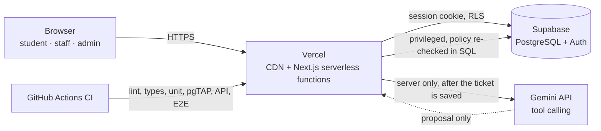

# MakeItRight

**AI Cloud-Based University Complaint System.** Students report campus maintenance problems in a
minute, a bounded AI agent routes routine reports to the right department, staff resolve them,
and every step is recorded.

**Live:** <https://makeitright-takeasy1.vercel.app> · Built for a cloud computing course and
selected for the PHEC Honhaar PINTEC Expo 2026.

> **Prototype notice.** This is not an official university reporting channel. Use fictional
> accounts and complaints only. Do not submit real personal, harassment, medical, disciplinary or
> emergency reports. Free-tier AI inputs may be used by the provider to improve its products.

## What it does

| Role               | Can do                                                                                                   |
| ------------------ | -------------------------------------------------------------------------------------------------------- |
| Student            | Report an issue (what, where, details), follow its timeline, confirm the fix or reopen it                |
| Department staff   | See only their department's queue, acknowledge, start work, add notes, mark resolved                     |
| Administrator      | Dashboard, review queue for anything the AI did not route, reassign any ticket, retry AI, manage routing |
| AI agent (bounded) | Propose a category, department and priority through three tools; it never writes to the database itself  |

Lifecycle: `submitted → triaging → assigned → in_progress → resolved → closed`, with
`needs_review` for anything a person must decide and `reopened` when a fix did not work.

## Architecture



- **Saved first, always.** A ticket is committed before any AI call, so an AI failure can never
  lose a report.
- **AI suggests, rules decide.**
  - The model can only look up the approved route, propose a route, or ask for a human.
  - The server's policy checks every proposal, then `agent_finish_run` checks it again in SQL.
  - High-priority, safety-related and unclear reports always go to a person.
- **The database enforces access.** Row-level security and audited `SECURITY DEFINER`
  functions decide who sees and changes what. The app server cannot bypass them.
- **Nothing is overwritten silently.** Optimistic versions stop lost updates, idempotency keys
  stop duplicate submissions, and the audit trail is append-only.

Design decisions: [`docs/adr/`](docs/adr). Plan progress:
[`docs/progress-tracker.md`](docs/progress-tracker.md).

## Stack

| Layer         | Choice                                                                |
| ------------- | --------------------------------------------------------------------- |
| App and API   | Next.js 16 App Router, React 19, TypeScript (strict), Tailwind CSS 4  |
| Hosting       | Vercel Hobby: serverless functions + CDN                              |
| Data and auth | Supabase: PostgreSQL 17, Auth, row-level security                     |
| AI            | Google Gemini (`gemini-3.1-flash-lite`) via `@google/genai`, tool use |
| Validation    | Zod on every input and every model or database payload                |
| Tests         | Vitest, pgTAP, Playwright + axe-core (desktop and Pixel 7)            |
| CI            | GitHub Actions + pnpm                                                 |

Everything runs on free tiers.

## Measured results

From [`docs/evidence/`](docs/evidence). Every figure comes from a script in this repository.

| What                                       | Result                                                              |
| ------------------------------------------ | ------------------------------------------------------------------- |
| 1 / 5 / 20 concurrent signed-in submits    | 0 errors; p95 147 / 103 / 227 ms (local production build)           |
| Duplicate submits with the same key        | 20 / 20 pairs → one ticket each; 10 simultaneous → 1 ticket         |
| Live production, 20 concurrent requests    | 0 errors; p95 538–933 ms from Pakistan                              |
| Failure drills (AI off, provider down, DB) | 22 / 22 checks; no report lost, no false success                    |
| AI triage on held-out reports              | macro-F1 0.981 (`triage-v3`)                                        |
| Automated tests                            | 382 unit, 222 pgTAP, 80 API integration, 151 E2E with accessibility |

## Run it locally

Requirements: Node.js 24 LTS, pnpm 11 (`corepack enable` selects the pinned version), Docker
Desktop.

```bash
git clone https://github.com/Saadullahasif47/make_it_right.git
cd make_it_right
pnpm install
pnpm db:start        # local Supabase in Docker: Postgres, Auth, Data API, Mailpit inbox
pnpm db:env          # writes .env.local for the local stack (never committed)
pnpm dev             # http://localhost:3000
```

Create the fictional demo accounts (two students, electrical and IT staff, one admin) and the
demo tickets:

```bash
DEMO_ACCOUNT_PASSWORD='choose-one-123' pnpm seed:demo
docker exec -i supabase_db_makeitright psql -U postgres -d postgres < supabase/demo/demo-tickets.sql
```

Sign in as `student.one@makeitright.test`, `electrical.staff@makeitright.test` or
`admin@makeitright.test` with that password. Sign-up emails arrive in Mailpit at
<http://127.0.0.1:54324>.

AI triage is off by default, and every report then waits in the admin review queue. To switch
it on, see [local development](docs/runbooks/local-development.md#ai-triage-locally-phase-4).

Cloud setup (Supabase project, Vercel variables, auth URLs) is in
[cloud environments](docs/runbooks/cloud-environments.md). Releasing, the demo day checklist and
rollback are in [release](docs/runbooks/release.md).

## Scripts

| Command                 | What it does                                                         |
| ----------------------- | -------------------------------------------------------------------- |
| `pnpm dev`              | Development server                                                   |
| `pnpm check`            | lint + typecheck + format check + unit tests + production build      |
| `pnpm test`             | Unit and component tests (no Docker needed)                          |
| `pnpm db:test`          | pgTAP database security tests (local stack)                          |
| `pnpm test:integration` | Auth and Data API tests against the local stack                      |
| `pnpm test:e2e`         | Playwright against the production build (run `pnpm build` first)     |
| `pnpm eval:agent`       | Live AI evaluation on labelled reports (needs a Gemini key)          |
| `pnpm db:reset`         | Rebuild the local database from migrations and seed                  |
| `pnpm db:types`         | Regenerate TypeScript types from the local schema                    |
| `pnpm seed:demo`        | Create or refresh the demo accounts                                  |
| `pnpm load:test`        | 1/5/20 concurrent submissions with idempotency and DB checks (local) |
| `pnpm drills`           | Failure drills: AI off, provider down, DB failure, races (local)     |
| `pnpm latency:cloud`    | Read-only latency probe of the live site                             |
| `pnpm smoke`            | Read-only release smoke test; checks the deployed commit             |

## HTTP API

All endpoints use the signed-in session cookie, answer JSON with `Cache-Control: no-store` and an
`x-request-id`, refuse cross-site browser requests, and report errors as
`{ "error": { "code", "message", "requestId", "fields"? } }`.

| Method and path                      | Who                   | Result                                                         |
| ------------------------------------ | --------------------- | -------------------------------------------------------------- |
| `POST /api/complaints`               | Student               | 201 created / 200 replayed; requires an `Idempotency-Key` UUID |
| `GET /api/complaints`                | Signed in             | Visible tickets; `?limit` (≤ 50), `?cursor`, `?status`         |
| `GET /api/complaints/[id]`           | Viewer of ticket      | Ticket with timeline; 404 if missing or not visible            |
| `PATCH /api/complaints/[id]/status`  | Staff, admin, student | `{ target, expectedVersion, note? }`; 409 if the ticket moved  |
| `POST /api/complaints/[id]/review`   | Admin                 | Classify and assign: `{ departmentId, category, priority, … }` |
| `POST /api/complaints/[id]/retry-ai` | Admin                 | One bounded AI retry for a ticket awaiting review              |
| `GET /api/admin/metrics?window=30`   | Admin                 | Dashboard aggregates for 7, 30 or 90 days                      |
| `GET /api/health`                    | Anyone                | `{ status, version, environment }`                             |

## Project layout

```
src/
  app/                 routes only: pages and route handlers orchestrate, no business logic
    (public)/          landing page
    (auth)/            sign-in, sign-up, password recovery
    (app)/             signed-in areas: /student, /department, /admin
    api/               the HTTP API above
  proxy.ts             session refresh and signed-out redirects
  features/            domain modules: complaints, agent, admin, auth, health
  components/          shared presentation components
  lib/                 config (the only place env is read), logging, http, supabase clients
supabase/
  migrations/          schema, RLS, audited functions (forward-only)
  tests/               pgTAP security and workflow tests
  seed.sql             departments and routing rules
  demo/                fictional demo tickets
scripts/               env, demo accounts, load test, drills, latency, smoke
tests/                 unit, integration, e2e, eval
docs/                  adr, runbooks, evidence, demo script, progress tracker
```

## Known limitations

- **Shared database.** One free Supabase project serves production and previews, with
  fictional data only (ADR 0002, ADR 0007).
- **Email.** The built-in sender allows only a few emails per hour. Demos use the seeded
  accounts.
- **Free tiers.**
  - The database pauses after about a week idle.
  - Gemini's free tier has rate limits. When they are hit, reports wait for human review.
- **Deferred features.**
  - No photo evidence (ADR 0006).
  - No email or push notifications.
  - English only.
  - Roles are assigned by script, not in the app.
- **Security headers.** These are set, but a nonce-based Content Security Policy is not yet in
  place.

## Engineering rules

The master plan is the specification. In short:

- Strict TypeScript, no `any`, no unexplained lint suppressions, no scattered `process.env`.
- Authorization is enforced by the database **and** the server.
- AI output is untrusted, and the app works without it.
- Every change leaves lint, typecheck, tests and build green. Each phase was merged only when its
  gate passed ([progress tracker](docs/progress-tracker.md)).
