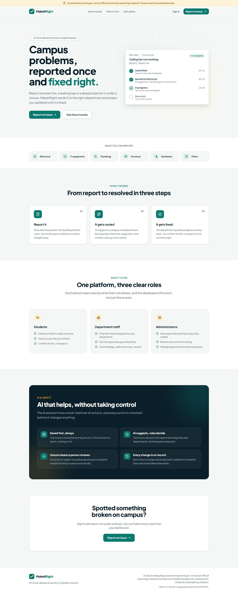
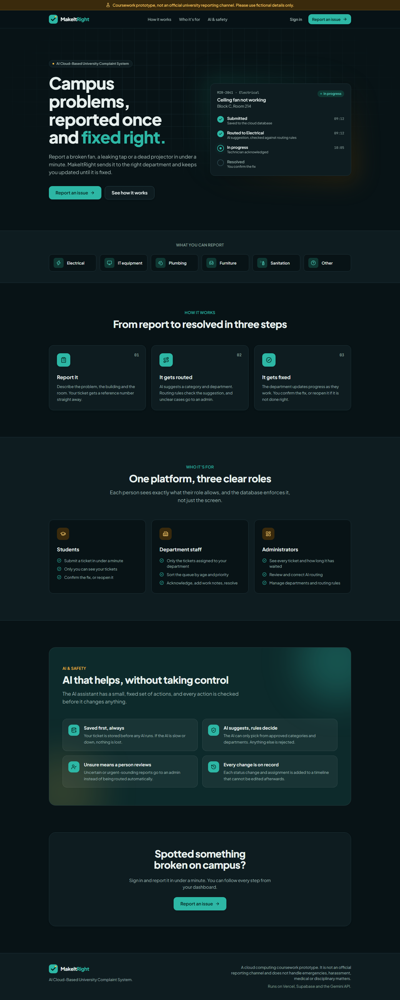
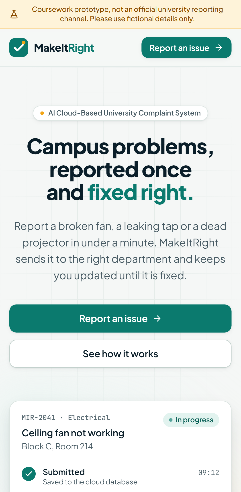

# Evidence: Phase 0, repository and quality baseline

**Gate P0:** GitHub CI passes, the Vercel preview loads, and a clean checkout builds with the
documented environment steps.

## Task checklist (plan §15)

| ID    | Task                                                           | Status  | Evidence                                                                 |
| ----- | -------------------------------------------------------------- | ------- | ------------------------------------------------------------------------ |
| P0.01 | Private repo; README with MVP scope and no-sensitive-data rule | Done    | `README.md`; repository visibility: private                              |
| P0.02 | Maintained Next.js App Router TypeScript project with pnpm     | Done    | Next.js 16.4.2, React 19.3, pnpm 11.5.1, Node 24                         |
| P0.03 | Strict TypeScript, ESLint rules, formatting                    | Done    | `tsconfig.json`, `eslint.config.mjs`, `prettier.config.mjs`; probe below |
| P0.04 | Section 12 folder structure and `.env.example`                 | Done    | `src/{app,components,features,lib}`, `supabase/`, `tests/`, `docs/`      |
| P0.05 | Vitest, Playwright scaffold, GitHub Actions workflow           | Done    | `vitest.config.mts`, `playwright.config.ts`, `.github/workflows/ci.yml`  |
| P0.06 | Simple `/` page and unauthenticated `GET /api/health`          | Done    | Screenshots below; E2E `health-and-headers.spec.ts`                      |
| P0.07 | `pnpm lint`, `typecheck`, `test`, `build` locally              | Done    | Local results below                                                      |
| P0.08 | Vercel preview deploy; `/api/health` from another device       | Pending | Needs the Vercel project to be connected                                 |

## Local verification (2026-10-22, Windows 11, Node 24.16.0)

| Command             | Result                                                          |
| ------------------- | --------------------------------------------------------------- |
| `pnpm lint`         | Pass, 0 problems (`--max-warnings=0`)                           |
| `pnpm typecheck`    | Pass                                                            |
| `pnpm format:check` | Pass                                                            |
| `pnpm test`         | Pass: 8 files, **82 tests**                                     |
| `pnpm audit --prod` | No known vulnerabilities                                        |
| `pnpm build`        | Pass. `/` and `/login` are static; `/api/health` is dynamic (ƒ) |
| `pnpm test:e2e`     | Pass: **34 tests** (17 specs × desktop Chromium + Pixel 7)      |

**Lint rule probe.** A throwaway file containing `any`, a floating promise, `console.log`,
`process.env` and `==` produced exactly 5 errors, one per rule. This confirms the type-aware
rules are active and not silently skipped.

## Defects found by testing and fixed in this phase

1. **Dead `/login` link.** On mobile, the E2E console check caught a 404 from Partial
   Prefetching of `/login`. Fixed with a branded holding page that P1.05 replaces. A new test
   now requests every internal link on the landing page and expects 200.
2. **Invisible content outside the viewport.** Scroll-driven reveal animations left sections
   at opacity 0 in full-page screenshots, and axe-core had been skipping them. Fixed by removing
   scroll reveal. A new test asserts every heading and list item is fully opaque without
   scrolling.
3. **Low-contrast decorative numerals** (1.6:1). These were found only after fix 2 exposed the
   hidden content. Fixed by using the AA-compliant subtle-ink token and `aria-hidden`.

## What the tests cover

- **Config:** defaults, the AI flag/key interaction, boolean parsing, rejection of ambiguous
  values, empty values treated as unset, URL scheme checks, SHA format, and error messages that
  list variable names but never values.
- **Logger:** JSON shape, level filtering, reserved keys that cannot be spoofed, child bindings,
  no stack traces, redaction of 13 sensitive key patterns at any depth, depth and array limits.
- **Request IDs:** uniqueness across 500 IDs; rejection of injection, newline, short, long and
  wrong-prefix IDs.
- **API errors:** every catalog code produces the §11 body, `no-store` and `x-request-id`.
- **Health:** ok body, short SHA, no secret leakage, request-ID echo, and a safe 503 with a
  server-side log line when configuration is invalid.
- **UI:** a single h1, all six categories, named regions, CTA targets, the decorative mock-up
  hidden from assistive technology, and button keyboard/disabled behaviour.
- **E2E:** zero console errors, axe WCAG 2.1 AA in light and dark themes, no horizontal scroll,
  skip link first in tab order, in-page navigation, the branded 404, an API 404, POST returning
  405, the health endpoint never prerendered, and security headers on pages and API.

## Screenshots

| Desktop, light                         | Desktop, dark                        | Mobile (Pixel 7)                 |
| -------------------------------------- | ------------------------------------ | -------------------------------- |
|  |  |  |

## Remaining to close the gate

- [x] GitHub Actions run green on the Phase 0 pull request:
      [run 39666341234](https://github.com/Saadullahasif47/make_it_right/actions/runs/39666341234)
      on `ec4d56a` (every step passed, 34/34 E2E on ubuntu-latest, 2 min 22 s).
- [ ] Vercel preview URL loads; `/api/health` returns `{"status":"ok"}` from a second device.
- [ ] E2E suite passes against the preview (`PLAYWRIGHT_BASE_URL=<preview> pnpm test:e2e`).
