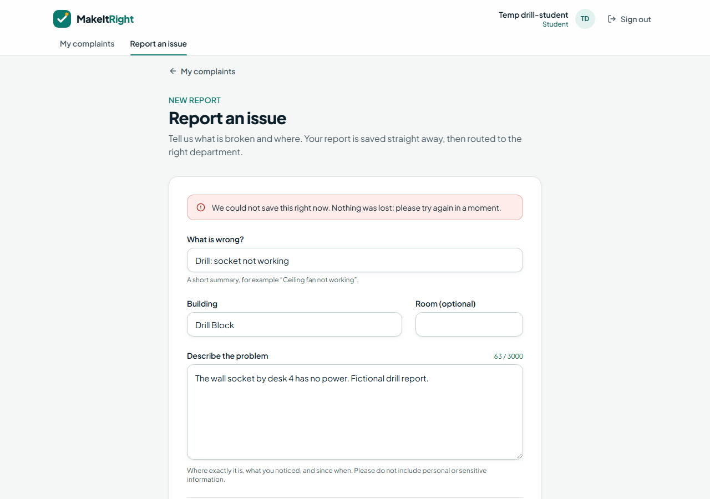

# Evidence: failure drills (local stack)

Run on 2026-11-03 with `scripts/failure-drills.mts` against `http://localhost:3100`
(production build, local Supabase). Faults were injected on purpose and removed afterwards.

**22 / 22 checks passed.**

### 1. AI switched on, but no Gemini key configured

| Check                                      | Result | Observed                                    |
| ------------------------------------------ | ------ | ------------------------------------------- |
| the report is accepted                     | PASS   | HTTP 201 in 221 ms                          |
| the ticket is stored and waits for review  | PASS   | status needs_review                         |
| the failure is recorded with a stable code | PASS   | PROVIDER_NOT_CONFIGURED                     |
| the audit trail is complete                | PASS   | created → triage_started → review_requested |

### 2. Gemini unreachable (provider down)

| Check                                      | Result | Observed                                    |
| ------------------------------------------ | ------ | ------------------------------------------- |
| the report is accepted                     | PASS   | HTTP 201 in 215 ms                          |
| the ticket is stored and waits for review  | PASS   | status needs_review                         |
| the failure is recorded with a stable code | PASS   | PROVIDER_UNAVAILABLE                        |
| the audit trail is complete                | PASS   | created → triage_started → review_requested |

### 3. The database write fails (fault injected on insert)

| Check                                                 | Result | Observed                                                                            |
| ----------------------------------------------------- | ------ | ----------------------------------------------------------------------------------- |
| the API reports a failure, never success              | PASS   | HTTP 503, code SERVICE_UNAVAILABLE                                                  |
| no ticket was stored                                  | PASS   | 2 before, 2 after                                                                   |
| no idempotency key was consumed                       | PASS   | 0 keys stored                                                                       |
| the form shows the error and keeps the student's text | PASS   | "We could not save this right now. Nothing was lost: please try again in a moment." |
| once storage recovers, the same submission succeeds   | PASS   | HTTP 201                                                                            |

### 4. Ten simultaneous duplicate submissions (one idempotency key)

| Check                                    | Result | Observed                                                       |
| ---------------------------------------- | ------ | -------------------------------------------------------------- |
| every response points to the same ticket | PASS   | 1 distinct id(s)                                               |
| exactly one response says created        | PASS   | 1 created, 9 replays (200,200,200,200,200,200,200,201,200,200) |
| exactly one ticket is stored             | PASS   | 1 ticket(s)                                                    |
| exactly one 'created' audit event        | PASS   | 1 event(s)                                                     |

### 5. Two electrical staff start work on the same ticket at the same moment

| Check                                       | Result | Observed                      |
| ------------------------------------------- | ------ | ----------------------------- |
| the admin assignment succeeds               | PASS   | HTTP 200, version 2           |
| exactly one change wins, the other gets 409 | PASS   | HTTP 200 and 409              |
| the loser is told the ticket changed        | PASS   | STALE_VERSION                 |
| the ticket moved forward exactly once       | PASS   | status in_progress, version 3 |
| exactly one audit event for the change      | PASS   | 1 status_changed event(s)     |

What the student sees when storage fails (drill 3):

