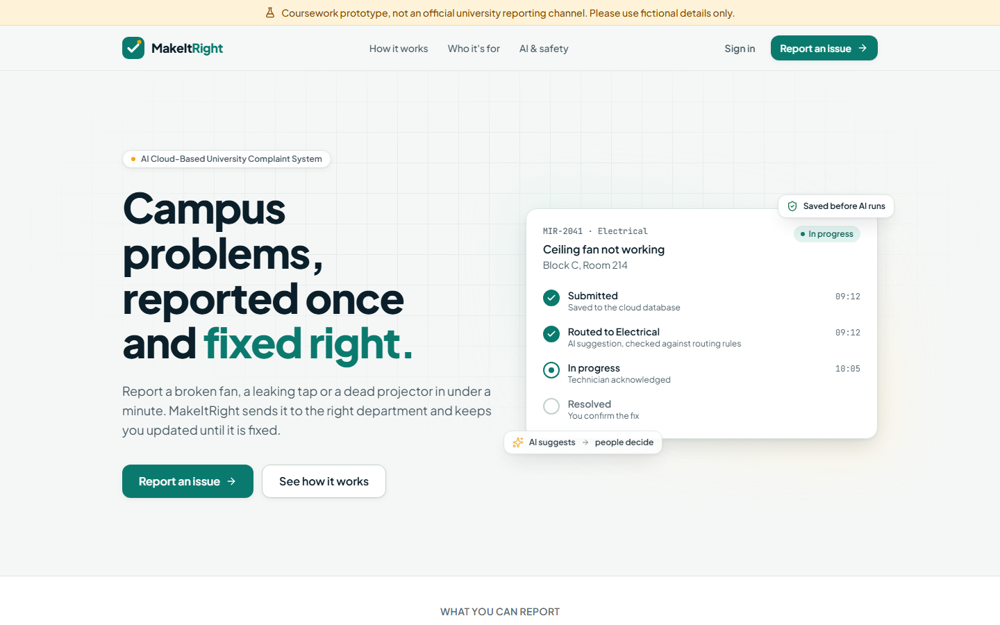
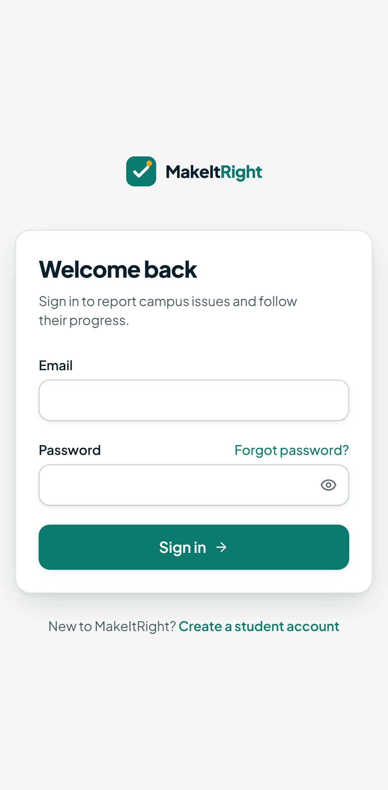

# Evidence: Phase 7, production release

**Gate P7:** live Vercel link works; full demo passes; cloud evidence, runbook, source and
evaluation delivered.

Production: <https://makeitright-takeasy1.vercel.app> (Vercel Hobby) on the Supabase project
`makeitright-staging`, which is production by decision (ADR 0007).

## Task checklist (plan §15)

| ID    | Task                                                           | Status  | Evidence                                                                                 |
| ----- | -------------------------------------------------------------- | ------- | ---------------------------------------------------------------------------------------- |
| P7.01 | Reviewed migrations and demo departments on production         | Done    | 5 / 5 migrations match; 6 departments and 6 enabled routes (below)                       |
| P7.02 | Fresh fictional demo students, staff and admin                 | Done    | 5 demo accounts; 12 demo tickets via `supabase/demo/demo-tickets.sql`                    |
| P7.03 | Production Vercel variables, auth redirect URLs, Gemini key    | Done    | Set in P1–P4 ([cloud-environments.md](../runbooks/cloud-environments.md)); AI live below |
| P7.04 | Final PR with green CI and preview E2E                         | This PR | CI runs the full suite on every PR                                                       |
| P7.05 | Deploy and verify the active commit                            | Done    | `pnpm smoke`: deployed `7651b82` = `main` (re-checked after this merge)                  |
| P7.06 | Final smoke: login, create, route/review, resolve, close       | Partly  | Read-only smoke 27 / 27; signed-in run is the owner's rehearsal                          |
| P7.07 | Cloud evidence: dashboard, rows, functions, CI, AI tool result | Partly  | Below; the signed-in admin dashboard screenshot comes from the rehearsal                 |
| P7.08 | Practise the 7-minute demo and 3-minute Q&A, AI on and AI off  | Owner   | [demo-script.md](../demo-script.md) with a rehearsal log                                 |
| P7.09 | Rollback steps, known limitations, code freeze                 | Done    | [release.md](../runbooks/release.md), README; tag `v1.0.0` after merge                   |

## Cloud evidence (2026-11-03)

### Database (Supabase PostgreSQL, read with `supabase db query --linked`)

| Item                           | Value                  |
| ------------------------------ | ---------------------- |
| Migrations, local = remote     | 5 / 5                  |
| Active departments             | 6                      |
| Enabled default routes         | 6 (one per category)   |
| Accounts                       | 5 (all fictional demo) |
| Tickets                        | 16                     |
| Audit events (`ticket_events`) | 58                     |

The 16 tickets:

- **MIR-1001 to MIR-1004:** from development checks.
- **MIR-1005 to MIR-1016:** the demo set: 1 submitted, 5 assigned, 2 in progress, 2 resolved
  and 2 closed, across all six departments.
- **All 16 together:** 1 submitted, 1 awaiting review, 7 assigned, 2 in progress, 2 resolved
  and 3 closed.

  Each demo ticket was created and moved by the demo accounts through the audited functions. MIR-1012 shows
  the full loop, including a reopen:

| Event          | By         | From        | To          | Note                                           |
| -------------- | ---------- | ----------- | ----------- | ---------------------------------------------- |
| created        | student    |             | submitted   |                                                |
| assigned       | admin      | submitted   | assigned    |                                                |
| acknowledged   | department | assigned    | assigned    |                                                |
| status_changed | department | assigned    | in_progress |                                                |
| status_changed | department | in_progress | resolved    | Tightened the regulator knob.                  |
| status_changed | student    | resolved    | reopened    | The fan still only runs on full speed.         |
| status_changed | department | reopened    | in_progress | Replacing the regulator unit itself this time. |

(Shown from the identical local run; the cloud run produced the same states.)

### AI tool results (production `agent_runs`)

| Ticket   | Model                   | Prompt      | Tool call            | Proposal         | Server verdict        | Duration |
| -------- | ----------------------- | ----------- | -------------------- | ---------------- | --------------------- | -------- |
| MIR-1002 | `gemini-3.1-flash-lite` | `triage-v3` | `propose_assignment` | electrical, high | review: high priority | 2.6 s    |
| MIR-1004 | `gemini-3.1-flash-lite` | `triage-v3` | `propose_assignment` | electrical, low  | accepted, routed      | 4.3 s    |

The same model proposed both routes. The server routed the routine one and held the high-priority
one for a person, which is the policy working as designed.

### Vercel functions and deployment

`pnpm smoke` against production: **27 / 27 checks passed**. They cover:

- the health function reports `7651b82` in `production`;
- 4 public pages render with all security headers and without `x-powered-by`;
- 6 signed-in areas redirect visitors to `/login?next=…`;
- 5 API routes answer anonymous callers with 401 `UNAUTHENTICATED`, `no-store` and a request id;
- a cross-site submission gets 403.

Live latency at 20 concurrent requests: p95 538–933 ms, 0 errors
([p6-cloud-latency-production.md](p6-cloud-latency-production.md)).

### Screenshots

| Live landing page (desktop)                      | Live sign-in (Pixel 7)                                        |
| ------------------------------------------------ | ------------------------------------------------------------- |
|  |  |

Earlier phase evidence also shows the app working: the AI tool-call view
([p4-tool-calls.png](p4-tool-calls.png)) and the database-failure message
([p6-drill-database-failure.png](p6-drill-database-failure.png)).

### CI

Every phase merged on green GitHub Actions runs. The last one before this PR was run `41667446770`
(PR #7):

- lint, typecheck and build;
- 382 unit tests;
- 222 pgTAP tests;
- 80 API tests;
- 151 E2E tests with accessibility checks.

## Release gate (plan §23)

| Gate item                                                          | Status | How it is shown                                                        |
| ------------------------------------------------------------------ | ------ | ---------------------------------------------------------------------- |
| Production URL accessible from a different computer                | Owner  | Open the URL on a phone on mobile data during rehearsal                |
| No personal real-user data in AI prompts, screenshots, logs, seeds | Yes    | Fictional accounts and tickets only; logs carry no complaint text (P6) |
| Current Git commit equals deployed version                         | Yes    | `pnpm smoke` compares `/api/health` with `git rev-parse HEAD`          |
| Lint, types, unit, RLS, E2E tests and production build pass        | Yes    | CI on every PR; numbers above                                          |
| Three roles work; student and department data isolated             | Yes    | pgTAP + API integration + E2E per role; owner rehearsal                |
| Repeated submits never duplicate for one idempotency key           | Yes    | Load test 20 / 20 pairs; drill 10 simultaneous → 1 ticket              |
| Agent failure never loses data; unauthorised tool args rejected    | Yes    | Drills 1–2; P4 policy and SQL re-check tests                           |
| No exposed secrets; no paid tier activated                         | Yes\*  | P6 review; Hobby + Free plans. \*Rotate the demo password (ADR 0007)   |
| A real cloud resource with measured performance, not mocked        | Yes    | Live latency probe and production rows above                           |
| Demo script rehearsed; README has exact setup steps                | Owner  | [demo-script.md](../demo-script.md) rehearsal log; README              |

**Gate P7:** open until the owner's rehearsal. It needs three things:

- the signed-in demo run on production, with the dashboard screenshot;
- a check from another device;
- the demo password rotated.
