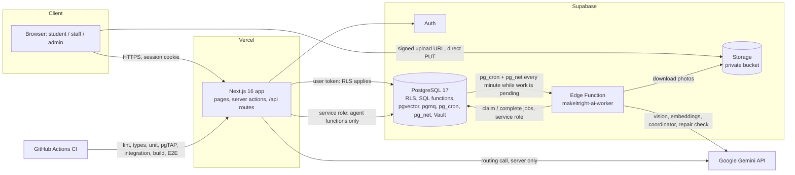

# 04. Technology stack and decisions

Only technologies that are really in the repository are listed. Sources:
[`package.json`](../../package.json), [`supabase/config.toml`](../../supabase/config.toml),
[`supabase/migrations/`](../../supabase/migrations), [`.github/workflows/ci.yml`](../../.github/workflows/ci.yml),
[ADR 0001](../adr/0001-stack-and-repository-structure.md).

**Not used**, although sometimes assumed: shadcn/ui, Radix, Recharts (charts are server-rendered
SVG/HTML), any ORM (SQL functions are called directly), Supabase Realtime (pages re-read instead),
LangChain or any agent framework (the agent loops are our own code), and any self-trained model.

## Architecture at a glance

---

## Application layer

### Next.js 16 (App Router), `next@16.4.2`

1. **What:** a React framework that renders pages on the server and also hosts API routes.
2. **Used for:** every page, every `/api/*` endpoint, server actions behind forms, session refresh
   in [`src/proxy.ts`](../../src/proxy.ts).
3. **Why:** one deployable for UI and API; first-class on Vercel; server components keep secrets
   and database calls on the server.
4. **How:** pages are React Server Components rendered on the server; only interactive pieces
   are client components. With Cache Components, a route is static unless it reads request data;
   session pages call `connection()` so they are always dynamic.
5. **Where:** `src/app/**`.
6. **Alternatives:** separate React SPA + Express/NestJS API; Remix; Laravel/Django.
7. **Why not:** two deployables, CORS, and duplicated validation; the course centres on serverless
   deployment.
8. **+/−:** + fast, secure by default for server code; − fast-moving framework (version 16
   features like Cache Components caused one real bug: a prerendered "not found" for flagged pages,
   fixed in A6).
9. **Without it:** we would need another server and router for both UI and API.
10. **Replaceable:** the business logic lives in `src/features` and SQL, so another framework could
    call the same functions.

### React 19 and TypeScript 5 (strict)

- **React** builds the UI from components; server components by default, client components for
  forms and uploads.
- **TypeScript** in strict mode plus `noUncheckedIndexedAccess`, `noImplicitOverride`,
  `noImplicitReturns`, `verbatimModuleSyntax`. ESLint `strictTypeChecked`, a ban on `process.env`
  outside `src/lib/config`, and a rule that every lint suppression needs a reason.
- **Why:** many states and roles; types catch mistakes at build time. Database types are generated
  from the schema (`pnpm db:types`) and CI fails if they drift.
- **Alternative:** plain JavaScript, rejected for safety in a multi-role system.

### Tailwind CSS 4 (+ `clsx`, `tailwind-merge`, `lucide-react`)

- Utility classes for layout and colour; tokens for light and dark themes with at least 4.5:1
  contrast (WCAG AA). `cn()` merges classes; Lucide provides icons.
- Container queries let the Photos section lay out by its own width (side by side on the
  reporter's page, stacked in the narrow staff column).
- **Alternatives:** CSS modules, a component kit like shadcn/ui or MUI. A kit adds dependencies
  and a look we would fight; Tailwind gave full control with no runtime cost.

### Zod 4

- **What:** schema validation for TypeScript.
- **Used for:** every form and API input (`strictObject`, so injected fields are rejected), every
  environment variable at boot, every model output, every database payload before rendering.
- **Why:** one schema gives both a runtime check and a type. SQL check constraints repeat the same
  limits, and a unit test fails if they drift.
- **Without it:** malformed AI output or requests could reach the database or the screen.

### `server-only`

Marks modules that must never be bundled for the browser (e.g. the privileged Supabase client).
The build fails if a client component imports them.

---

## Data, auth and backend: Supabase

Supabase is a hosted PostgreSQL with Auth, Storage, Edge Functions and extensions. One free
project, `makeitright-staging`, serves both production and previews
([ADR 0007](../adr/0007-production-release.md)).

### PostgreSQL 17

- **Used for:** all data, and most business rules as SQL functions (create, transition, assign,
  link, coordinate, alerts, metrics).
- **Why:** transactions, constraints, row locks and RLS make the rules hold even if the app has a
  bug. 27 tables, all with RLS.
- **Alternative:** Firebase/Firestore (NoSQL). Rejected: weak joins and aggregation for the
  heatmap and metrics, and no transactional multi-row rules like "link a report and supersede its
  candidates atomically".

### Row-Level Security (RLS)

- **What:** database policies that filter rows per user. A query for "all complaints" returns only
  what that user may see.
- **Why:** access control that the web server cannot forget. Default grants were revoked so every
  new table starts closed; a pgTAP test fails if anything new is open.
- **Details:** [document 6](06-database-design.md#5-row-level-security).

### `SECURITY DEFINER` functions

Every write goes through a SQL function that checks the role and rules itself, with a pinned
`search_path`. No role, admins included, has direct `INSERT/UPDATE/DELETE` on `complaints` or
`ticket_events`.

### Supabase Auth (`@supabase/ssr`, `@supabase/supabase-js`)

Email/password accounts, cookie sessions refreshed by `proxy.ts`, verified on the server with
`getClaims()`. There is no browser Supabase client.

### Supabase Storage

Private bucket `complaint-evidence` (2 MiB, JPEG/PNG/WebP). Uploads go browser → Storage with a
signed URL, so photo bytes never pass through Vercel. Viewing uses five-minute signed URLs.

### Edge Function `makeitright-ai-worker` (Deno)

- **What:** a serverless function running on Supabase's Deno runtime.
- **Used for:** all background AI jobs (F1–F4). Logic lives in
  [`supabase/functions/_shared/`](../../supabase/functions/_shared) as plain TypeScript so Vitest
  can test it in Node.
- **Why here, not Vercel:** it sits next to the database and Storage, runs on a schedule, and keeps
  long AI work out of user requests. Budget: 110 s per run (Edge limit 150 s), 45 s per job.
- **Auth:** a shared secret header `x-worker-secret`, compared in constant time.

### pgmq (Supabase Queues)

- **What:** a message queue inside PostgreSQL (Supabase Queues is built on it).
- **Used for:** queue `makeitright_ai_jobs`; each message is only `{"job_id"}`.
- **Why:** the job row and its message are written in the **same transaction** as the photo or
  report that caused them, so work is never lost or duplicated. Visibility timeouts give crash
  recovery.
- **Alternatives:** Redis/BullMQ, AWS SQS, Inngest. Each is another service, and none can join our
  database transaction.

### pg_cron, pg_net and Vault

- `pg_cron` runs `private.invoke_ai_worker()` every minute (it only calls the worker when work is
  pending) and the insights refresh daily at 02:20.
- `pg_net` makes the HTTP call to the worker from SQL.
- Vault stores the worker URL and secret per environment.

### pgvector

- Stores 768-dimension embeddings in `complaint_embeddings` and computes cosine similarity in SQL.
- **Why:** vectors next to the cases they describe; one query filters by building, date and
  status and ranks by similarity.
- **Alternatives:** Pinecone, Weaviate, Qdrant. A separate vector service would add cost and
  require keeping two stores in sync.

---

## AI: Google Gemini

| Package / path                | Used by                                                                              |
| ----------------------------- | ------------------------------------------------------------------------------------ |
| `@google/genai` 2.29.1        | Routing agent in the Next.js app ([`gemini.ts`](../../src/features/agent/gemini.ts)) |
| Plain `fetch` to the REST API | The Edge worker (no SDK in the Deno runtime)                                         |

- **Models:** `gemini-3.1-flash-lite` (routing, vision, coordinator, repair check),
  `gemini-3.5-flash` (routing backup), `gemini-embedding-2` (768-d embeddings).
- **Why Gemini:** one provider for text, images, tool calling, structured JSON output and
  embeddings; a free tier suitable for a student project; a "lite" model with low latency.
- **Alternatives:** OpenAI GPT models, Anthropic Claude, open models (Llama) on our own GPU. Paid
  APIs had no free tier for the course; self-hosting needs GPUs and operations.
- **Replaceable:** the routing agent talks to a provider-neutral `ModelClient` interface; tests use
  scripted models. Switching provider means one new adapter plus re-running the evaluations.
- **Downsides:** free-tier rate limits and "high demand" 503 streaks (seen during evaluations);
  inputs on the free tier may be used by Google to improve products (README notice), which is why
  only fictional data is used.

---

## Hosting and delivery

### Vercel (Hobby)

- Serves the Next.js app: static pages from the CDN, dynamic pages and APIs as serverless
  functions. Every push gets a preview URL; `main` deploys to production.
- Environment variables per environment (Preview / Production); secrets marked Sensitive.
- **Alternatives:** Netlify, Render, a VPS. Vercel is the reference platform for Next.js.
- **Rollback:** Instant Rollback to a previous deployment.

### GitHub Actions

One job ([`ci.yml`](../../.github/workflows/ci.yml)): install (frozen lockfile) → lint → typecheck
→ format → unit tests → `pnpm audit` (high fails) → local Supabase in Docker → generated types
match → pgTAP → integration → build → Playwright (desktop and Pixel 7). Actions are pinned to
commit SHAs; the token is read-only. Every PR must pass before merge.

### pnpm 11, Node.js 24, Docker

pnpm with a frozen lockfile; Node 24 LTS; Docker runs the local Supabase stack for development and
CI.

---

## Testing tools

| Tool                                 | Purpose                                                            |
| ------------------------------------ | ------------------------------------------------------------------ |
| Vitest 5 (+ Testing Library, jsdom)  | Unit and component tests; integration tests; live evaluations      |
| pgTAP (via `supabase test db`)       | Database tests: RLS, grants, functions, constraints                |
| Playwright + `@axe-core/playwright`  | End-to-end on desktop Chrome and Pixel 7, with accessibility scans |
| ESLint + typescript-eslint, Prettier | Static checks and formatting                                       |

Details in [document 9](09-security-reliability-and-testing.md).

---

## Cross-cutting concepts

| Concept                     | How it works here                                                                                                                                                                      |
| --------------------------- | -------------------------------------------------------------------------------------------------------------------------------------------------------------------------------------- |
| REST API                    | 19 route handlers under `src/app/api`. JSON only, `Cache-Control: no-store`, an `x-request-id`, one error shape `{ error: { code, message, requestId } }`, cross-site requests refused |
| Server actions              | Forms post to server functions; the form and the API call the **same** use case (`submitComplaint`), so they cannot diverge                                                            |
| Server vs client components | Data fetching and authorization in server components; client components only for interactivity (forms, uploads, theme)                                                                 |
| Sessions                    | Supabase cookies, refreshed in `proxy.ts`, verified per request; role read from `profiles` each time                                                                                   |
| Environment variables       | Read only in `src/lib/config`, parsed by Zod at boot; vague values like "maybe" refuse to start; the test stub URL is refused on any deployment                                        |
| Database queries            | Typed RPC calls to SQL functions; no SQL strings built from user input                                                                                                                 |
| Asynchronous processing     | Routing: synchronous within the submit request (bounded 10 s). F1–F4: queued jobs processed by the Edge worker                                                                         |
| Serverless                  | Vercel functions for requests; one Edge Function for jobs; no always-on server                                                                                                         |
| Error handling              | Stable error codes from SQL (`MR403`, `MR404`, `MR409`, `MR412`, `MR422`, `MR429`) mapped to HTTP; AI failures to stable codes (`TIMEOUT`, `RATE_LIMITED`, …)                          |
| Logging                     | JSON-lines logger; redacts credentials, identities and complaint text; one `http.request` line per API call with route, status, duration and request id; viewable in Vercel logs       |
| Monitoring                  | Admin dashboard AI stats, `/admin/jobs`, Vercel and Supabase dashboards, `pnpm smoke`. No external APM (e.g. Sentry) is set up                                                         |
