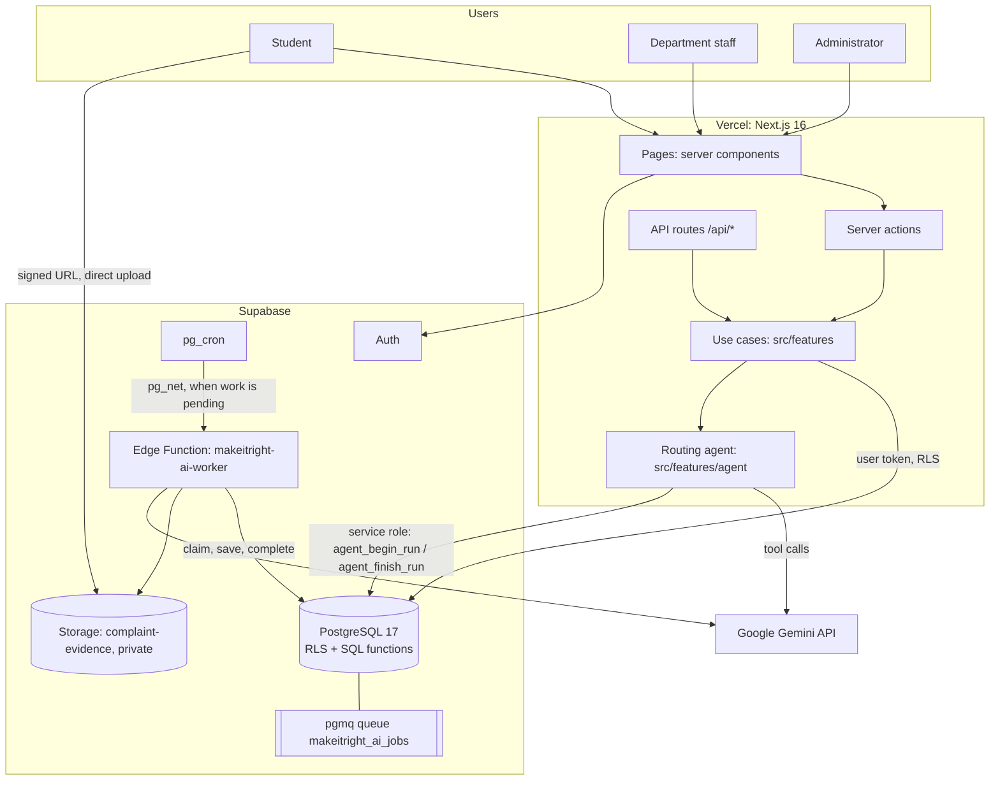
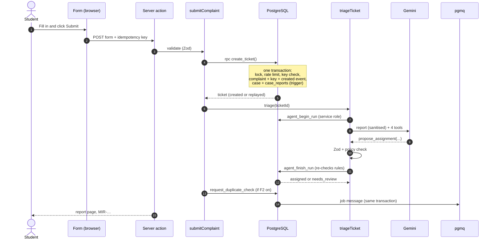
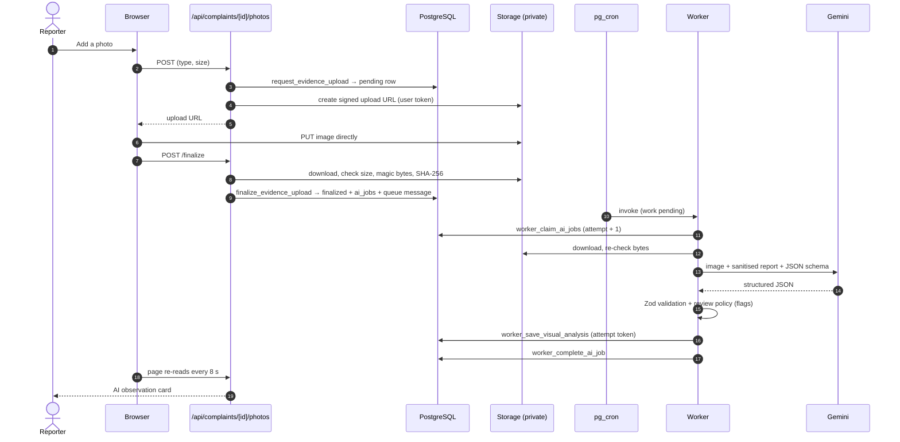
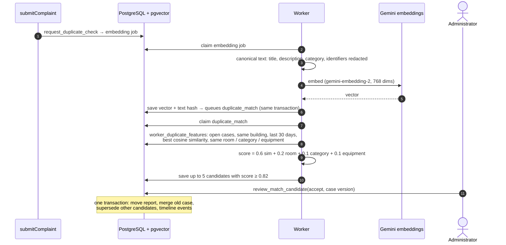
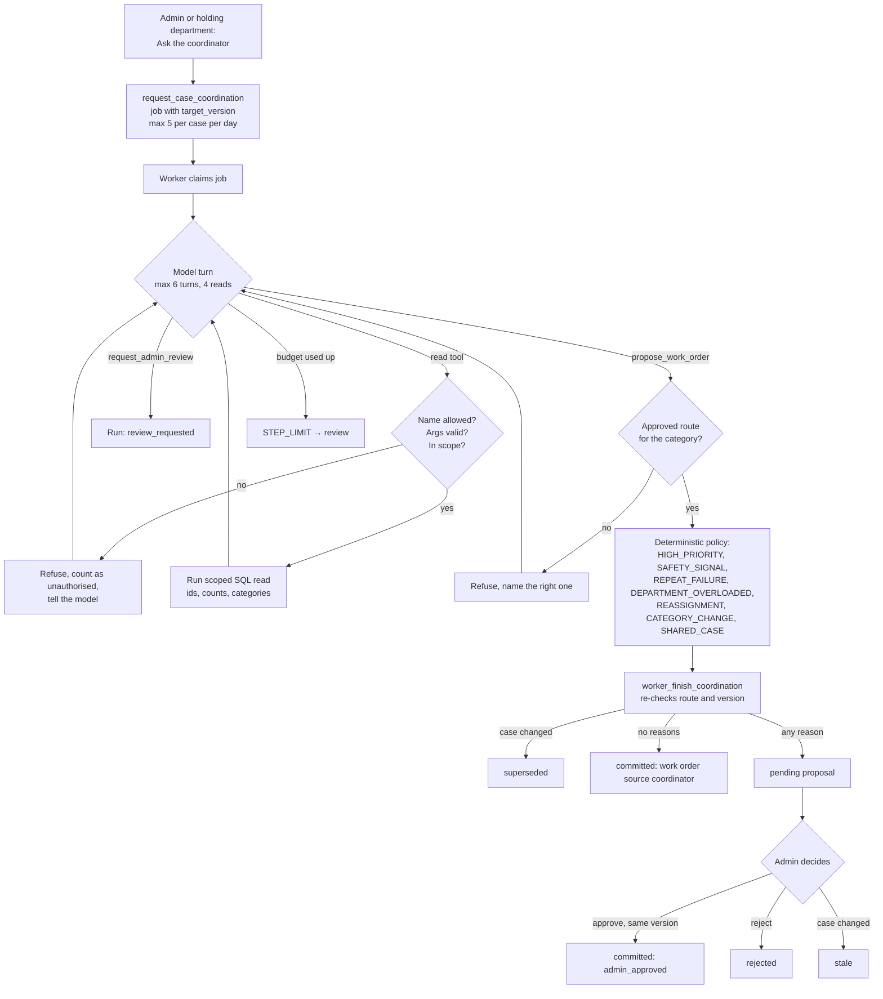
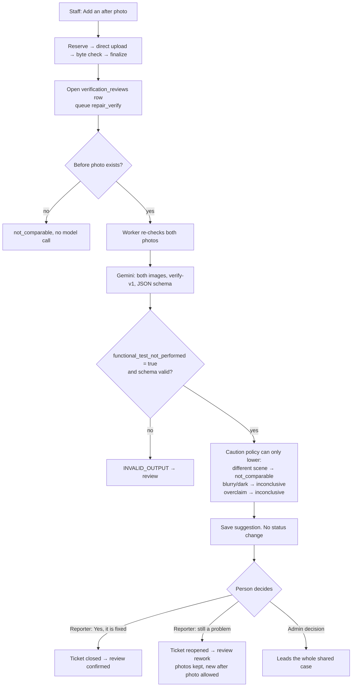
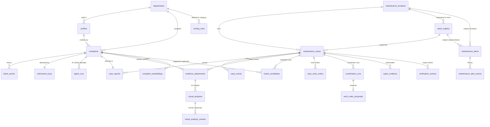
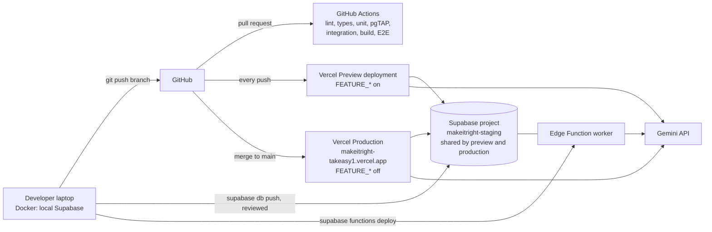

# 05. System architecture and data flow

## 1. The layers, in plain words

| Layer         | What it is                                                                   | Where in the code                                                         |
| ------------- | ---------------------------------------------------------------------------- | ------------------------------------------------------------------------- |
| Frontend      | React server and client components rendered by Next.js                       | `src/app/**/page.tsx`, `src/components`, `src/features/*/components`      |
| Backend       | Server actions and API route handlers that call feature "use cases"          | `src/app/api/**/route.ts`, `src/features/*/{actions,service,api}.ts`      |
| Rules         | SQL functions, constraints, triggers and RLS policies                        | `supabase/migrations/*.sql`                                               |
| AI (sync)     | The routing agent, inside the submit request                                 | `src/features/agent/`                                                     |
| AI (async)    | The background worker: photos, embeddings, matching, coordinator, repair     | `supabase/functions/makeitright-ai-worker`, `supabase/functions/_shared/` |
| Scheduling    | pg_cron jobs calling the worker and refreshing insights                      | migrations `ai_jobs_and_evidence_storage`, `heatmap_and_insights`         |
| Configuration | Zod-validated environment, feature switches                                  | `src/lib/config/`                                                         |
| Security      | Session check per page, RLS, grants, privileged client confined to the agent | `src/features/auth/session.ts`, `src/lib/supabase/`                       |

The rule that holds the design together: **pages and routes orchestrate; SQL decides.** The app
never writes a table directly; it calls audited functions that check the caller and the rules.

## 2. High-level architecture

## 3. What happens when a student clicks "Submit"

Traced through the actual code:

1. **Browser.** `complaint-form.tsx` posts the form (title, description, building, room, and a
   hidden idempotency key rendered once by the server).
2. **Server action.** [`src/features/complaints/actions.ts`](../../src/features/complaints/actions.ts)
   creates a Supabase client with the user's session and calls `submitComplaint` with two
   dependencies: `triage` and `afterCreate` (the duplicate check).
3. **Authentication.** The client verifies the session; `requirePageAccess` already confirmed the
   student role. (`POST /api/complaints` goes through the same use case, plus JSON-only, 16 KB cap
   and a cross-site check.)
4. **Validation.** Zod `strictObject` checks every field.
5. **Durable write.** [`repository.ts`](../../src/features/complaints/repository.ts) calls
   `rpc("create_ticket")`. In **one transaction** the SQL function: takes a per-user advisory lock,
   checks the rate limit (20 per 10 minutes) and the idempotency key, inserts the complaint,
   the key and the `created` event; triggers open a maintenance case and link the report.
6. **AI routing.** `triageTicket` ([`triage.ts`](../../src/features/agent/triage.ts)):
   `agent_begin_run` → Gemini → policy → `agent_finish_run` (assign or review) → keyword fallback
   if needed. It never throws; a failure leaves the stored ticket as it is.
7. **After create.** If duplicate detection is on,
   [`enqueue.ts`](../../src/features/duplicate-detection/enqueue.ts) calls
   `request_duplicate_check`, which writes an `ai_jobs` row and a pgmq message.
8. **Response.** Redirect to the report page with "We have your report" and the reference.
9. **Later (async).** Within about a minute, pg_cron sees pending work and calls the worker, which
   embeds the report and looks for duplicates.

If Gemini fails in step 6, the ticket is already saved; it goes to `needs_review` (or is routed by
the backup model or keyword rules). If step 5 fails, the student sees "We could not save this
right now. Nothing was lost: please try again", and their text stays in the form (failure drill 3).

## 4. AI visual inspection sequence

## 5. Duplicate detection sequence

## 6. Coordination agent workflow

## 7. Repair verification flow

## 8. Database entity relationships (core)

Not shown: `ai_jobs` (referenced by analyses, runs and reviews), `config_changes`,
`maintenance_sla_policies`. An alert lists its evidence cases in a `case_ids` array, not a foreign
key. Full table descriptions in [document 6](06-database-design.md).

## 9. Deployment architecture

Key facts:

- **One Supabase project for preview and production** (free plan limit), with only fictional data
  ([ADR 0007](../adr/0007-production-release.md)).
- Migrations are forward-only and additive; they are applied to the cloud by hand after review,
  never by CI.
- Feature switches are Vercel environment variables; changing one needs a redeploy.
- Secrets: `SUPABASE_SECRET_KEY`, `GEMINI_API_KEY` on Vercel (Sensitive); `AI_WORKER_SECRET`,
  `GEMINI_API_KEY`, `AI_ENABLED`, `GEMINI_MODEL` as Edge Function secrets; worker URL and secret
  in Vault.

## 10. Source map

| Component                     | Location                                                                                |
| ----------------------------- | --------------------------------------------------------------------------------------- |
| Submit use case               | `src/features/complaints/service.ts`                                                    |
| Ticket repository (RPC calls) | `src/features/complaints/repository.ts`                                                 |
| Routing agent                 | `src/features/agent/{triage,run-agent,gemini,policy,safety,sanitize,keyword-router}.ts` |
| Session and access            | `src/features/auth/session.ts`, `src/proxy.ts`                                          |
| Config and feature switches   | `src/lib/config/server-config.ts`                                                       |
| Photo upload                  | `src/features/evidence/`, `src/app/api/complaints/[id]/photos/`                         |
| Worker entry                  | `supabase/functions/makeitright-ai-worker/index.ts`                                     |
| Worker jobs and retries       | `supabase/functions/_shared/jobs/`                                                      |
| Vision                        | `supabase/functions/_shared/visual-inspection/`                                         |
| Duplicates                    | `supabase/functions/_shared/duplicates/`, `src/features/duplicate-detection/`           |
| Coordinator                   | `supabase/functions/_shared/coordination/`, `src/features/coordination/`                |
| Repair verification           | `supabase/functions/_shared/repair-verification/`, `src/features/repair-verification/`  |
| Heatmap and insights          | `src/features/heatmap/`, `src/features/insights/`                                       |
| Schema and rules              | `supabase/migrations/` (15 files)                                                       |
